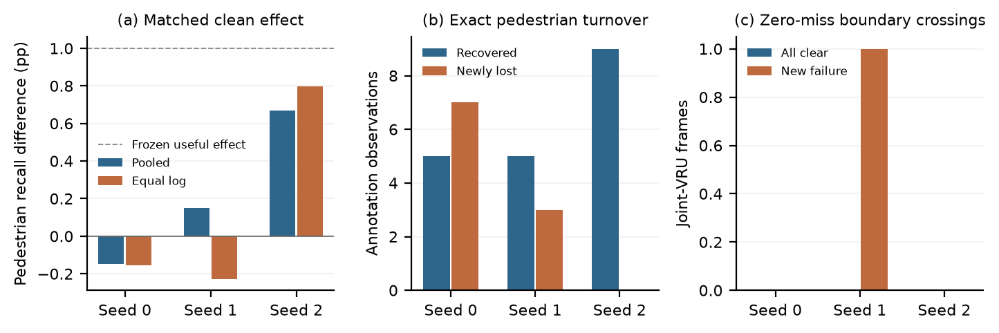

# Layer-Gate BEV: matched conditioning and critical misses

[One-page research summary](docs/research-summary.pdf) · [New mechanism paper](paper/matched-conditioning-study.pdf) · [LaTeX](paper/mechanism-latex/) · [Compact reproduction](studies/gate-mechanism-20261028/README.md) · [Historical eleven-page report](paper/critical-miss-evaluation.pdf)

**Author:** Xiaotong Wu<br>
Illinois Risk Lab (IRisk Lab), University of Illinois Urbana-Champaign<br>
xiaotongwu116@gmail.com | Research Advisor: Dr. Zhiyu Quan

## Bounded mechanism follow-up: 2026-10-28

**Question:** with the same inherited detector, sampling, updates, parameter shapes and inference paths, does bounded frame conditioning recover critical pedestrians beyond an input-independent gate?

The new study **did not meet the frozen useful-effect criterion; candidate expansion stops**. It uses the same historically exposed nuScenes mini data: 162 outer frames from four capture logs, 1,347 critical pedestrian observations and 1,590 joint-VRU observations. Seeds 0/1/2 are model replicas on these same logs, not independent datasets. No fresh-data, causal, SOTA, calibrated-safety or collision-risk result is claimed.

Twelve matched trajectories use existing same-fold/seed U8000 parents and exactly 200 gate-only plus 400 encoder/gate updates. Dynamic and constant-descriptor gates each have 29,380 parameters and execute actual feature pooling. Decoder LiDAR processing is identical and frozen. No new development/outer result chooses a checkpoint or candidate; all trained results use final600. The neutral reference is the already trained U8000 detector with no new adaptation, not a random untrained network.

### All primary seed results

C is the constant-descriptor control; D is the bounded dynamic gate. Recall changes are percentage points. AnyMiss means at least one critical VRU missed in a target-containing frame. Recovered/newly lost counts are annotation observations, not distinct people.

|Seed|Pedestrian hits C to D|Recall change (pp)|Joint AnyMiss C to D|Pedestrian recovered / newly lost|
|---|---|---:|---|---|
|0|410 to 408 / 1347|-0.148|131 to 131 / 137|5 / 7|
|1|486 to 488 / 1347|+0.148|124 to 125 / 137|5 / 3|
|2|424 to 433 / 1347|+0.668|130 to 130 / 137|9 / 0|



Every log, seed, fixed secondary view, exact target/frame transition, SDK mAP/NDS/pedestrian AP and support, and saved/unmatched output burden is retained in the new paper and companion. SDK metrics are evaluated on pooled boxes, not averaged fold AP. Separate per-log SDK descriptions retain class support. Saved/unmatched outputs at score >=0.1 are burden diagnostics, not official false positives or precision. All outputs remain uncalibrated; old monitor scores are not transferred to changed boxes.

### What the mechanism audit clarifies

- The original gate already had neutral initialization and a same-sized A3 constant-descriptor control. This follow-up adds a bounded coefficient residual, common actual pooling and exact new identity records; capacity matching itself is not a novelty claim.
- All original A arms shared the frozen decoder LiDAR path. Its presence alone is not a differential architectural confound. The new contrast is conditional on that shared path; inference-only masking measures sensitivity, not retrained path-free efficacy.
- An isolated CPU execution of the customized attention method confirms an all-empty geometric camera-mask fallback doubles the residual. Its real-frame incidence and detection impact are not evaluated. This is implementation evidence, not a detector benefit or identified cause of the results.

New computation: 7,200 scientific optimizer updates plus three engineering updates; 1.438 conservative single-GPU reserved hours including CPU/I/O and inference. The original U8000 training is reused and not counted as new work. The fixed budget is closed after the declared comparisons; unused ceilings are not a further search allocation.

Python 3.11+, standard library only for compact arithmetic reproduction:

```bash
python scripts/verify_release.py
python studies/gate-mechanism-20261028/public_reproduce_compact.py
```

The public package reproduces saved identity/count arithmetic. Detector checkpoints, full predictions, sensor data and full annotation tables are retained locally and are not redistributed. This is a compact analysis companion, not an end-to-end detector training release. Same-process AI code/protocol/numerical checks are not external researcher replication. Code development used AI assistance.

## Preserved historical study

The [original eleven-page report](paper/critical-miss-evaluation.pdf) and [historical summary](docs/archive/research-summary-v1.0.3.pdf) remain byte-preserved. Its full404 gate effects use seeds0/1; seed2 retains a separate incomplete 243-frame/six-log cohort. The 176/192 A matrix, original failures and nulls, permanent original NO_PROMOTION, and B2/B3 conditional stops are unchanged. No old launcher, failed experiment, damaged group, risk monitor or raw backup was restarted.

The original case analysis documented log-weight sign sensitivity, additional pedestrian hits without fewer failed-frame identities, and inconsistent fixed-budget risk screening. Those conclusions are not replaced by the smaller new panel. See [study status](docs/study-status.md), [reproduction scope](docs/reproducibility.md), [research development plan](docs/research-development-plan.md), and the complete R1-R3 artifacts under `analysis/`.

This is an exploratory research technical report. No peer-reviewed acceptance or DOI is asserted. The research advisor is not listed as a coauthor; no advisor review or endorsement is inferred. See [rights and data attribution](LICENSES_AND_DATA.md), [citation metadata](CITATION.cff), and [publication provenance](provenance/FOLLOWUP_UPDATE_v1.1.0.json).
