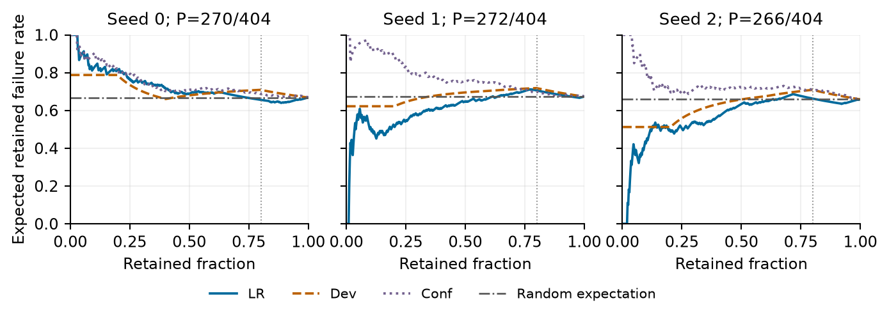

# Layer-Gate BEV: critical-miss evaluation

[One-page research summary](docs/research-summary.pdf) · [Summary text](docs/research-summary.md) · [Paper PDF](paper/critical-miss-evaluation.pdf) · [LaTeX](paper/latex/) · [Reproduction guide](docs/reproducibility.md) · [Versioned release](https://github.com/xiaotwu/layergate-bev-critical-miss-evaluation/releases/tag/v1.0.3)

**Critical-Miss Evaluation in Small-Sample BEV: Log-Weight Sensitivity and Risk-Monitor Limits**

**Author:** Xiaotong Wu  
**Affiliation:** Illinois Risk Lab (IRisk Lab), University of Illinois Urbana-Champaign  
**Email:** [xiaotongwu116@gmail.com](mailto:xiaotongwu116@gmail.com)  
**Research Advisor:** Dr. Zhiyu Quan

## Research question

**When do improvements in aggregate detection metrics fail to describe critical-target recovery, and can a frozen risk score identify missed-target frames at a stated alarm cost?**

This completed exploratory study examines three linked questions: how log weighting changes an apparent gate effect; why more pedestrian hits can leave frame-level failures unchanged; and whether probability accuracy, ranking quality and alarm utility support the same conclusion. The contribution is a reproducible case analysis of established evaluation principles in a small-sample BEV pipeline. It does not introduce a new estimator or establish stable gate efficacy.

## Study at a glance

| Element | Scope |
|---|---|
| Formal exploratory data | 404 nuScenes mini frames from eight capture logs; custom capture-log partition |
| Gate comparison | 176/192 primary groups retained; complete full404 effects use seeds0/1; seed2 has a separate 243-frame/six-log valid-fold cohort |
| Risk monitor | One fixed three-feature model; nine logistic fits and three predetermined one-class F3 fallbacks; all three seeds use the same logs |
| Follow-up analysis | Saved-count frame transitions and frozen-score ranking/alarm descriptions; no new detector outputs in R1–R3 |
| Public artifacts | Compiled report, authored LaTeX build inputs, compact records, full-precision outputs and read-only numerical reproduction commands |

The three seeds are model replicas on the same logs, not three independent datasets. **AnyMiss means at least one critical vulnerable road user (VRU) is missed in a frame.** It is not a collision-risk label and does not mean that every target was missed.

## Key findings

1. **Aggregation can change the direction of a reported effect.** For A2/seed0/LiDAR, pooled pedestrian recall changes by −0.2053 percentage points, while equal-log weighting gives +0.0756 points. Both describe the same 404 frames/eight logs under different weights; neither establishes external benefit. The complete paired descriptions retain all candidates and denominators.
2. **More target hits can leave exactly the same frames failed.** For A2/seed1/clean, pedestrian hits increase from 1,000/2,923 to 1,007/2,923, but all 17 count-improved frames still miss a pedestrian. Joint-VRU AnyMiss stays 288/307 target-containing frames, with exactly the same failed-frame identities. A separate local P2 development case recovers one frame and creates one new failure. Residual misses and offsetting transitions are different explanations for an unchanged total.
3. **A weak baseline can overstate screening value.** At the primary 80/404-alarm budget, the frozen logistic/fallback score exceeds the development-prevalence comparator in all three seeds, but exceeds same-volume random expectation only in seed0. Development-fixed thresholds show limited internal enrichment with substantial alarm drift. Probability losses, ranking and alarm cost therefore require separate evaluation.

Unsaved individual match identities prevent exact claims about which people were recovered or lost. Observed frame-count transitions and explicit target-turnover bounds are retained; these bounds are identification limits, not confidence intervals.

### Local detection-metric disagreement

A matched fixed-8,000-update, uncalibrated clean **development** comparison (F0/seed0; 41 frames, one log, six pedestrian instances/67 critical observations) changes mAP from **2.1758% to 2.5328%** and NDS from **7.2406% to 9.2326%**. Pedestrian AP remains **0**, critical pedestrian/joint-VRU hits rise from **8/67 to 15/67**, and AnyMiss remains **30/31** target-containing frames: one frame recovers and one newly fails. Aggregate AP gains come from car/cone, with truck decreasing. Saved pedestrian outputs at score ≥0.1 change **2,175→2,177**; all-range unmatched outputs change **2,165→2,160**, which are not official false-positive or precision measures. Motorcycle/bicycle support is absent. This small historically exposed case is descriptive and does not support outer promotion.

## Frozen risk-score results: signal and operating limits

LR is the saved logistic/one-class-fallback score; Dev is the same-fold development prevalence; Conf is one minus maximum pedestrian confidence. At the primary fixed budget of **80/404 alarms (19.802%)**, each seed covers the same 404 frames/eight logs:

| Seed | LR expected capture / failures | Dev capture | Conf capture | Same-volume random expectation |
|---|---:|---:|---:|---:|
| 0 | 57.58/270 | 40.49 | 47.00 | 53.47 |
| 1 | 43.56/272 | 39.51 | 46.00 | 53.86 |
| 2 | 51.47/266 | 36.54 | 35.00 | 52.67 |

Equal-log descriptions also lack a consistent advantage. The frozen consistency criterion **fails**; no winning seed or alarm budget is selected afterward. The original fixed monitor's Brier/NLL improvements are inconsistent.

When thresholds use development scores alone and are then held fixed, LR captures **+4.73/+13.18/+8.60** failures above random at each actual alarm volume. This is limited internal enrichment. Outer alarm fractions drift to **40.97%/23.90%/39.49%**, with gains concentrated in a few logs. Unflagged failure ratios remain **64.85%/63.04%/62.32%**. Increased capture at a larger alarm volume does not establish improvement at a fixed 20% budget.

Fractional alarm/capture counts are analytic expectations under uniform, label-independent boundary-tie allocation. Fixed-policy rates are ratios of expected counts, not expectations of ratios from an executed random policy. No randomized alarm system was deployed. Failure-event `AP_risk` is distinct from detector mAP/pedestrian AP; original detector outputs and metrics do not change in R1–R3.



## Scope and limitations

- Mini is the formal exploratory dataset, using a custom capture-log partition rather than the official challenge evaluation. Repeated frames/instances, overlapping fold training populations and historical/adaptive exposure limit inference. No new external logs or independent replication are available.
- The sixteen missing F0/seed2 groups are not filled. Full404 gate effects use only seeds0/1; the incomplete seed2 cohort is reported separately and does not form a three-seed full404 mean.
- One-log development fitting and detector checkpoint selection on that log limit monitor evaluation; all three predetermined one-class F3 fallbacks remain in the results.
- Detection baselines have low absolute AP and controls differ in parameterization. The A implementation has an additional decoder LiDAR path. B1 is LiDAR-only; camera/clean equality is an expected negative control, not implemented fusion evidence. B1 selections mix six 8k, three 6k and three 4k checkpoints, not uniform fixed8k controls.
- Mandatory P1 execution failure preserves the original **NO_PROMOTION** decision. B2/B3 retain their conditional stops for resource/support/implementation limits. Missing SDK effects and original risk fields retain their nulls.
- **Not established:** stable gate efficacy, consistent fixed-budget screening, calibrated safety risk, deployed alarm benefit, collision-risk reduction, causal effects, significance or external generalization. No iid-frame confidence intervals or p-values are supplied.

This is a learning/research technical report; no peer-reviewed acceptance, DOI or SOTA result is claimed. See [study status](docs/study-status.md), [risk-ranking analysis](analysis/risk_ranking/README.md), [matched recovery analysis](analysis/recovery/README.md) and the full-precision outputs for complete results.

## Explore and reproduce

Start with the [one-page summary](docs/research-summary.pdf) for the research question and findings, then the [paper](paper/critical-miss-evaluation.pdf) for methods, scope and limitations. The [reproduction guide](docs/reproducibility.md) maps the compact inputs and checks.

Python **3.11+**, standard library only; the documented commands require no GPU, SDK, model/data download or new training:

```bash
python scripts/verify_release.py
python analysis/r1/verify_saved_risk.py
python analysis/recovery/reproduce_recovery_compact.py
python analysis/recovery/verify_group_tables_sqlite.py --read-only
python analysis/risk_ranking/verify_ranking_alarm.py
```

These are same-author numerical reproduction and publication portability checks, **not external independent replication**. The archived R3 verifier reports 27,741 checks; R2 includes saved-count decompositions and finite identification-bound enumerations. No old evaluator, fit, source-capture or raw-backup operation is replayed. Candidate expansion is stopped.

The public release is a **compact analysis companion**, not an end-to-end detector training release. Raw sensor data, full nuScenes annotation tables, detector checkpoints, large prediction payloads and private execution controls are not redistributed. The complete local historical archive is retained separately. See [data and rights](LICENSES_AND_DATA.md).

## Further research questions

The [research development plan](docs/research-development-plan.md) separates applicant-led reasoning, external critique and future empirical work. These are prospective questions, not completed experiments or authorization to restart the stopped study:

- **Transfer:** does a policy frozen before evaluation retain failure-capture value and a manageable alarm burden on genuinely new capture logs? Another split of the already inspected mini logs cannot supply that external evidence.
- **Identification:** how do per-target recoveries, newly lost matches and within-frame identity swaps change the frame-level explanation when immutable match identities are saved during a future endpoint computation?
- **Attribution:** do the metric disagreements persist with stronger detectors and matched control parameterization, under a bounded design fixed before examining outcomes?

Independent compact-record reproduction and detailed reviewer feedback can strengthen confidence in the present analysis. They would not substitute for fresh-data validation or establish safety effectiveness.

## Provenance and citation

The [source-copy record](provenance/SOURCE_COPY_RECORD.json) maps accepted inputs and publication transformations; the [release manifest](provenance/PUBLIC_RELEASE_MANIFEST.json) binds current public bytes. Path-redacted or text-updated copies have their own hashes and are not represented as byte-identical to their archive sources. The original failures, versions, nulls and stopped experiments remain preserved. Publication history is in [the changelog](CHANGELOG.md).

The authored [LaTeX source](paper/latex/) uses IEEEtran from a normal TeX distribution; third-party class/style files are not vendored. See [build instructions](paper/latex/README.md) and [references.bib](paper/latex/references.bib). Use [CITATION.cff](CITATION.cff) for a versioned citation. The research advisor is not listed as a coauthor. **Code development used AI assistance.**

Academic Writing Toolkit's initial offline language-logic/BibTeX checks retain their historical scope in `provenance/academic-writing-toolkit/`. They are document assistance, not scientific peer review, online result verification or external replication. No repository-wide relicensing of the paper, code or upstream data is implied.
